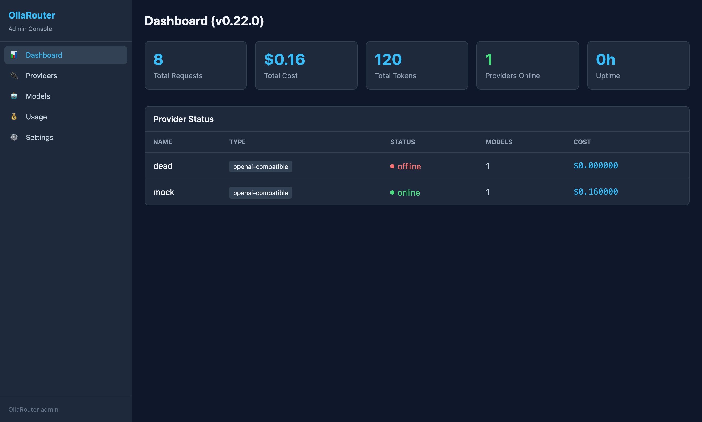
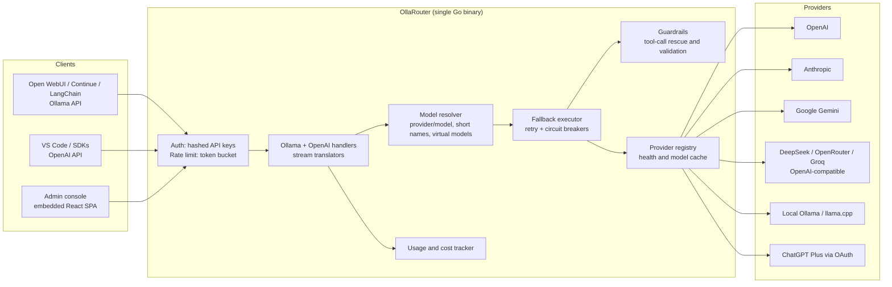
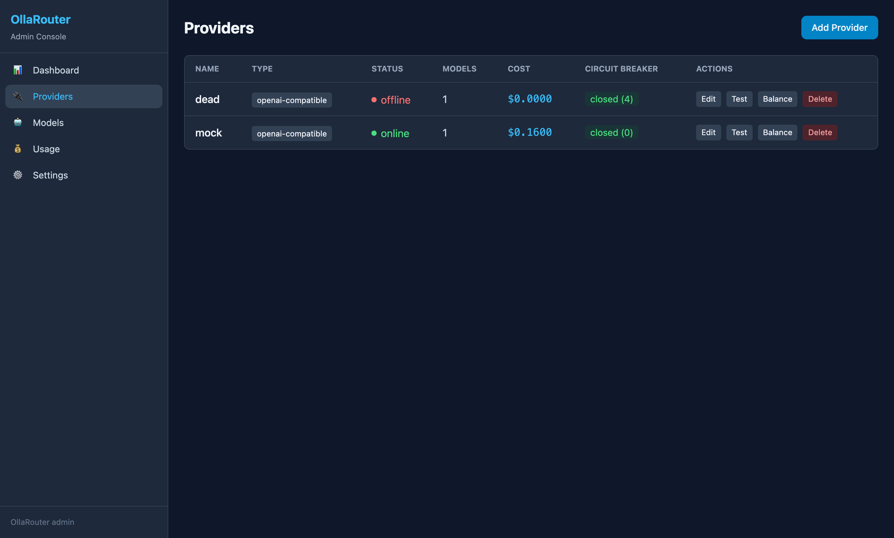
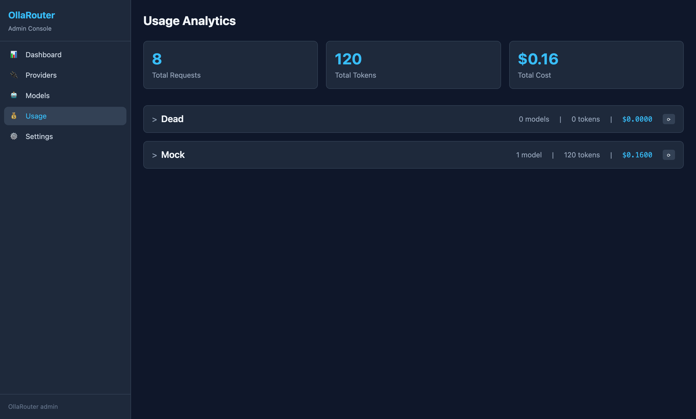

<div align="center">

# OllaRouter

**One local endpoint for every LLM: Ollama and OpenAI-compatible APIs in front of OpenAI, Anthropic, Gemini, DeepSeek, OpenRouter, Groq, local Ollama and ChatGPT subscriptions.**

A single Go binary with fallback chains, circuit breakers, tool-call guardrails for weaker local models, per-provider cost tracking, and an embedded admin console.

[](https://github.com/aideveloper1976-arch/ollarouter/actions/workflows/ci.yml)
[](https://github.com/aideveloper1976-arch/ollarouter/actions/workflows/codeql.yml)
[](LICENSE)


[Getting started](docs/getting-started.md) · [Architecture](docs/architecture.md) · [Configuration](docs/configuration.md) · [API reference](docs/api.md) · [Guardrails](docs/guardrails.md) · [Verification](docs/verification.md) · [Security](SECURITY.md)

</div>



## Why it exists

Tools such as Open WebUI, Continue, VS Code and LangChain already speak the Ollama API. OllaRouter
lets them use any provider without changing the client: point the tool at OllaRouter instead of
Ollama, and the same `/api/tags` and `/api/chat` calls reach GPT, Claude, Gemini, DeepSeek or your
local models. Clients that speak OpenAI's format get `/v1/chat/completions` from the same process.

| Problem | What OllaRouter does |
|---|---|
| Each tool needs its own provider setup | One endpoint and one list of models, named `provider/model` |
| A provider goes down or rate-limits mid-task | **Virtual models** with ordered fallback chains, retry with backoff and jitter, and a circuit breaker per provider |
| Local models emit broken tool calls (invalid JSON arguments, calls written as XML `<invoke>` blocks or fenced JSON) | **Guardrails** validate tool calls, rescue them from the text, retry, and never pass on a call the client can't parse |
| Reasoning text and tool markup leak into chat output | Output sanitiser strips leaked reasoning lines and tool tags, including in streams |
| No idea what each provider costs | Token and cost tracking per provider and model, plus live balance for DeepSeek and OpenRouter |
| LiteLLM-style gateways need Postgres and a large image | One static binary, no database, distroless image, three Go dependencies |

## At a glance

| | |
|---|---|
| **APIs served** | Ollama (`/api/chat`, `/api/generate`, `/api/tags`, `/api/show`, `/api/ps`, `/api/version`) and OpenAI (`/v1/chat/completions`), streaming and non-streaming |
| **Provider types** | `openai`, `anthropic`, `google`, `deepseek`, `openrouter`, `openai-compatible` (Groq, Together, llama.cpp, vLLM…), `ollama`, `chatgpt-plus` |
| **Resilience** | Virtual-model fallback chains, exponential backoff with jitter, per-provider circuit breaker, parallel health checks |
| **Guardrails** | Tool-call validation, rescue from XML / fenced JSON / raw JSON text, bounded retry, mixed-output policy; on by default for `ollama` and `openai-compatible` |
| **Security** | Bearer API keys (stored as SHA-256 hashes), per-key token-bucket rate limiting, `${ENV_VAR}` secrets in config, AES-256-GCM store for OAuth tokens, non-root distroless container |
| **Observability** | Structured JSON logs, Prometheus `/metrics`, `/health` and `/health/providers`, usage log and cost breakdowns in the admin API |
| **Admin console** | React + Tailwind SPA embedded in the binary: dashboard, providers (add, edit, test, balance), model catalogue, usage analytics, settings |
| **Size** | ~10.5k lines of Go, 25 test files with 190 test functions, plus a 15-check end-to-end smoke test run in CI |

## Architecture



A request names a model. The resolver maps it to a provider (`deepseek/deepseek-chat`), a short
name found in a provider's model cache, or a **virtual model** whose fallback chain is tried in
order. Each adapter translates to the provider's wire format and back, including streaming
(SSE in, NDJSON or SSE out). More detail is in [docs/architecture.md](docs/architecture.md).

## Quick start

```bash
git clone https://github.com/aideveloper1976-arch/ollarouter.git
cd ollarouter/ollarouter
cp providers.yaml.example providers.yaml   # edit: keep only providers you use
export OPENAI_API_KEY=...                   # keys come from the environment
export OLLAROUTER_API_KEY=$(openssl rand -hex 32)
go run ./cmd/ollarouter -config providers.yaml
```

Then point any Ollama client at `http://localhost:11435`, open the admin console at
`http://localhost:11435/admin/`, or call it directly:

```bash
curl http://localhost:11435/api/chat \
  -H "Authorization: Bearer $OLLAROUTER_API_KEY" \
  -d '{"model":"best-quality","messages":[{"role":"user","content":"Hello"}],"stream":false}'
```

Docker Compose (OllaRouter on port 11434 plus Open WebUI on port 3000) and all configuration
options are covered in [docs/getting-started.md](docs/getting-started.md) and
[docs/configuration.md](docs/configuration.md).

### Virtual models with fallback

```yaml
virtual_models:
  - name: best-quality
    fallback_chain:
      - openai-main/gpt-4o
      - anthropic-main/claude-sonnet-4
      - local-ollama/*        # "*" = first model the provider offers
```

If `openai-main` is down, rate-limited or its circuit breaker is open, the request goes to
Anthropic, then to the local model. The client sees one model called `best-quality`.

## Screenshots

| Providers, with live circuit-breaker state | Usage and cost by provider |
|---|---|
|  |  |

Screenshots come from the smoke-test setup: `mock` is a local mock provider and `dead` points at a
closed port, so it shows as offline and has counted failures.

## Verification

Every claim on this page is checked by something that runs. CI runs:

- `gofmt`, `go vet`, and `go test -race` across all Go packages
- a TypeScript type check and production build of the admin UI
- [`scripts/smoke-test.sh`](scripts/smoke-test.sh): builds the binary, starts it against a mock
  OpenAI-compatible provider and checks auth, both API styles, NDJSON and SSE streaming,
  fallback past a dead provider, cost tracking, health, metrics and the admin UI (15 checks)
- a Docker image build, a gitleaks secret scan, and CodeQL for Go and TypeScript

What has and has not been verified, including against real providers, is listed in
[docs/verification.md](docs/verification.md).

## Built with an agentic SDLC

OllaRouter was built with [Agentic SDLC](https://github.com/aideveloper1976-arch/agentic-sdlc), a
multi-agent delivery framework. The full trail of that run is kept in
[`docs/product`](docs/product): market research, competitor analysis against LiteLLM and Portkey,
UX design, backlog, architecture, implementation plan, and the gate checkpoints for build,
regression, browser UI testing, code review and security review.
[`ollarouter/docs`](ollarouter/docs) holds the follow-up run that added guardrails and upstream
OAuth.

## Project layout

```text
ollarouter/            Go service (module root)
  cmd/ollarouter/        entry point, config loading, wiring, -healthcheck
  internal/provider/     adapters: openai, anthropic, google, openaicompat, ollama, chatgpt
  internal/engine/       model resolver, fallback executor, retry, circuit breaker
  internal/guardrails/   tool-call rescue, validation, retry loop
  internal/router/       HTTP routes, Ollama/OpenAI handlers, admin API, metrics
  internal/streaming/    SSE ↔ NDJSON translators
  internal/auth/         API keys, rate limiting, upstream OAuth (PKCE) + encrypted store
  internal/tracking/     usage records, cost aggregation, file persistence
  internal/webui/dist/   built admin UI, embedded with go:embed
webui/                 React + Vite + Tailwind admin console source
scripts/               end-to-end smoke test and mock provider
docs/                  user docs, plus SDLC evidence under docs/product
docker-compose.yml     OllaRouter + Open WebUI
```

## Known limitations

These are documented rather than hidden. See [SECURITY.md](SECURITY.md) and
[docs/verification.md](docs/verification.md) for details.

- `monthly_budget_usd` on API keys is stored and shown but **not enforced**.
- The per-key `rate_limit` value is not applied yet. Every key gets the default bucket of
  60 requests per minute.
- Guardrails run on non-streaming `/v1/chat/completions` responses. Streaming responses and the
  Ollama `/api/chat` path get output sanitising but no tool-call rescue.
- Usage stats are in memory unless `usage_persistence: file` is set.
- The `chatgpt-plus` provider uses the ChatGPT Codex backend through OAuth. It is unofficial and
  may break or conflict with OpenAI's terms. Use it only with your own account and at your own risk.

## Contributing and licence

Issues and pull requests are welcome. See [CONTRIBUTING.md](CONTRIBUTING.md). Released under the
[MIT License](LICENSE).
