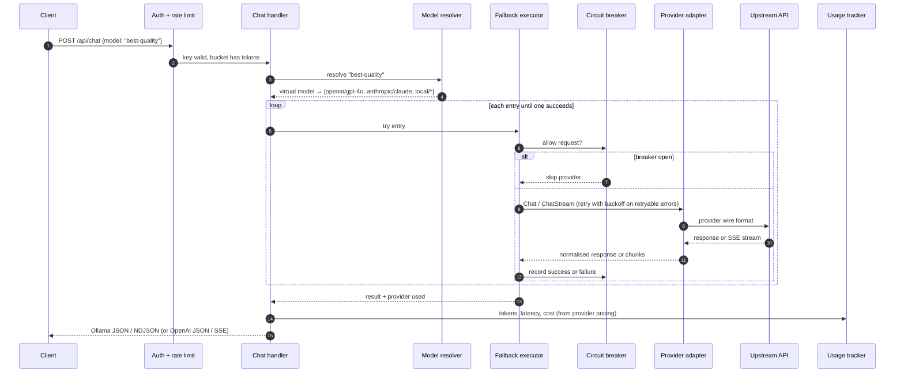
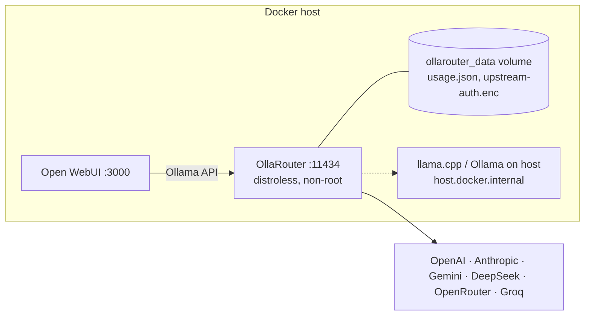

# Architecture

OllaRouter is one Go process with three dependencies (`go-chi/chi`, `go-chi/cors`, `yaml.v3`).
The admin UI is a React build embedded with `go:embed`. There is no database. State is the
config file, in-memory registries and an optional usage file.

## Request path

## Components

| Package | Role |
|---|---|
| `cmd/ollarouter` | Loads config, builds the registry, auth, tracker and fallback engine, starts the server, shuts down cleanly on SIGINT/SIGTERM, and provides `-healthcheck` |
| `internal/config` | YAML schema, defaults, validation (port range, unique names), `${VAR:-default}` interpolation, write-back |
| `internal/provider` | `Provider` interface, factory by `type`, registry with model cache and health. One adapter per wire format |
| `internal/engine` | `ModelResolver` (virtual → `provider/model` → short name), `FallbackExecutor`, `RetryEngine` (exponential backoff, jitter, retryable-error classification), `CircuitBreaker` (closed → open → half-open) |
| `internal/streaming` | Translators between provider streams (OpenAI SSE, Anthropic events, ChatGPT/Codex events) and the Ollama NDJSON writer |
| `internal/guardrails` | Tool-call rescue, validation and bounded retry for weaker models |
| `internal/router` | chi routes, Ollama and OpenAI handlers, output sanitiser, admin API, metrics, SPA handler |
| `internal/auth` | Bearer API keys (SHA-256 hashed), token-bucket rate limiter, upstream OAuth with PKCE and an AES-256-GCM credential file |
| `internal/tracking` | Usage records, cost aggregation by provider and model, periodic file persistence |
| `webui/` | React 18 + React Router + Tailwind admin console, built by Vite into `internal/webui/dist` |

## Design decisions

**Ollama API first.** Many local-first tools only speak Ollama. Serving that API means they work
unchanged. The OpenAI endpoint is there for SDKs and editors that need it.

**`provider/model` naming.** Every model is addressable without clashes, and `/api/tags` returns
one combined list.

**Fallback in the gateway, not the client.** Clients see one stable model name. Failover, retries
and breaker state live in one place and are visible in the admin console.

**Guardrails only where they help.** Strong hosted models rarely produce broken tool calls, so
guardrails default to on only for `ollama` and `openai-compatible` providers, where
small local models often do.

**No database.** For a personal or team gateway, a config file and in-memory counters (with
optional file persistence) keep it to one static binary and a 3-stage distroless image.

## Deployment

The product-level design documents from the original build (system architecture, provider adapter
contract, Docker architecture) are in [`docs/product/architecture`](product/architecture).
