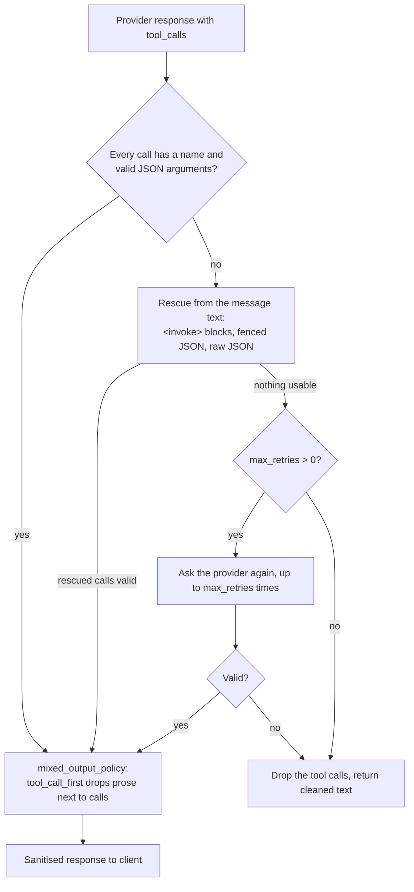

# Tool-call guardrails

Small local models often get tool calling nearly right. They emit the call as an XML `<invoke>`
block, wrap the JSON in a code fence, mix explanation with the call, or produce arguments that
aren't valid JSON. Agents and IDE assistants then fail or loop. Guardrails sit between the provider
and the client and repair what they can.

## What happens

1. **Validation** (`internal/guardrails/validator.go`) checks every structured tool call has a
   non-empty name and arguments that are valid JSON. A valid response passes through unchanged.
2. **Rescue** (`rescue.go`) runs when the tool calls are invalid. It pulls calls out of the message
   text (`<invoke name="…">` blocks with `<parameter>` children, fenced JSON blocks, raw JSON
   objects), removes that syntax from the visible text, and keeps the rescued calls if they validate.
3. **Retry** (`retry.go`) asks the provider again up to `max_retries` times until it returns valid
   calls.
4. **Fallback to text.** If nothing works, the broken tool calls are dropped and the cleaned text
   is returned. The client never receives a tool call it can't parse.
5. **Mixed output policy.** With `tool_call_first` (the default), prose that comes alongside valid
   tool calls is dropped so agents act on the call. `text_first` keeps both.

## Output sanitising (all providers)

Separately from guardrails, every assistant message is sanitised on both APIs, streaming
included. Lines that look like leaked reasoning ("Let me think", "I should", "Plan mode ACTIVE"…)
and tagged blocks such as `<system-reminder>`, `<tool_calls>`, `<invoke>` and `<parameter>` are
removed. Streams are buffered just enough to catch tags split across chunks.

## Defaults and scope

| Provider type | Guardrails by default |
|---|---|
| `ollama`, `openai-compatible` | on |
| `openai`, `anthropic`, `google`, `deepseek`, `openrouter`, `chatgpt-plus` | off |

Override per provider with a `guardrails:` block (see [configuration.md](configuration.md)).

**Current scope:** guardrails run on non-streaming `/v1/chat/completions` responses. Streaming
responses and the Ollama `/api/chat` path get output sanitising only.

## Tests

`internal/guardrails/*_test.go` covers the rescue formats, validation and the retry loop.
`internal/router/handler_chat_guardrails_test.go` and `handler_chat_sanitize_test.go` cover the
handler integration and the sanitiser, including tags split across stream chunks.
